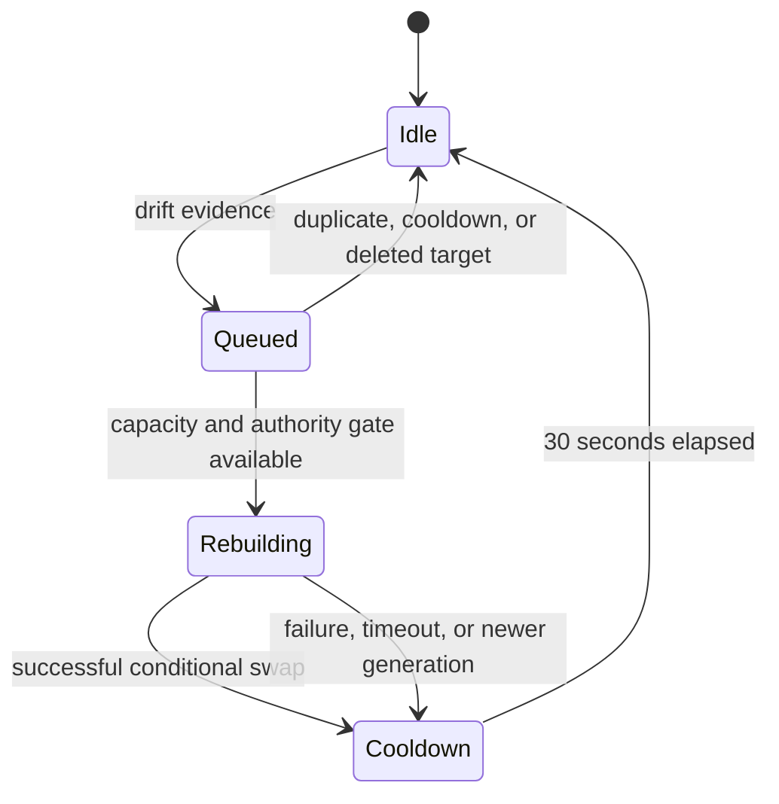

# reify-server

`ReifyServer::new(Arc<ProbeEngine>, Arc<SynthEngine>)` constructs a server without
starting tasks or requiring a runtime. `router()` returns an Axum router for
embedding or in-process tests. `serve(SocketAddr)` binds a Tokio TCP listener.
Cancellation drops the listener; dropping the final server/router owner also
aborts the healing worker and its in-flight browser jobs.

```rust,no_run
use std::sync::Arc;
use reify_server::ReifyServer;
use reify_probe::ProbeEngine;
use reify_synth::SynthEngine;

# async fn run() -> Result<(), reify_core::ReifyError> {
let server = ReifyServer::new(Arc::new(ProbeEngine::new()), Arc::new(SynthEngine::new()));
server.serve("127.0.0.1:8080".parse().unwrap()).await?;
# Ok(())
# }
```

This server instance represents one trusted principal. A public/multiuser host
must authenticate callers and give each principal its own instance/store. Mount
selection tokens prevent accidental cross-target tool selection; they do not
replace caller authentication. No target-network restrictions are imposed beyond
HTTP(S): this supports local development APIs as well as live public sites. Hosts
must impose their own target-access policy for untrusted callers.

## Stateless routing

POST `/mcp` requires `Content-Type: application/json`, Accept entries for both
`application/json` and `text/event-stream`, `MCP-Protocol-Version: 2026-07-28`, and
`Mcp-Method`. Tool calls additionally require a matching `Mcp-Name`; Base64 sentinel
names are decoded before comparison. Version metadata is mirrored in each body.
Malformed/duplicate routing headers produce HTTP 400 / `-32020`; unsupported
matching header/body revisions produce `-32022` with supported versions. Parse
errors use `-32700`, malformed requests `-32600`, invalid parameters `-32602`, and
unknown methods HTTP 404 / `-32601`. The request body limit is 1 MiB.

Origins are denied by default when present, preventing unintended browser-origin
access. Configure canonical origins with `with_allowed_origins` before cloning the
server. This validates origins; it does not add cross-origin browser CORS grants.
Non-browser clients can omit Origin. GET/DELETE `/mcp` receive HTTP 405.

The server chooses single JSON responses and emits `Mcp-Stream: false`; it does
not advertise SSE subscriptions. All successful results include server identity
in `_meta["io.modelcontextprotocol/serverInfo"]`. `server/discover` advertises modern
versions and tools capability. Requested `initialize` support is a compatibility
RPC returning the same protocol/capabilities, requiring current request metadata;
it does not establish a handshake or connection session. Notifications are not
accepted as request envelopes; this revision has no core HTTP notification method.
See [Streamable HTTP](https://modelcontextprotocol.io/specification/2026-07-28/basic/transports/streamable-http)
and [versioning](https://modelcontextprotocol.io/specification/2026-07-28/basic/versioning).

An unscoped `tools/list` exposes only the root `reify` tool. Bootstrap example:

```json
{
  "jsonrpc": "2.0",
  "id": 1,
  "method": "tools/call",
  "params": {
    "name": "reify",
    "arguments": {"url": "https://example.com", "goal": "search flights"},
    "_meta": {
      "io.modelcontextprotocol/protocolVersion": "2026-07-28",
      "io.modelcontextprotocol/clientCapabilities": {}
    }
  }
}
```

The result's `structuredContent` contains `mount`, `tools`, and `primaryToolName`.
Pass the opaque token in `params._meta["reify/mount"]` on later `tools/list` and
compiled `tools/call` requests. Each request routes independently; there is no
implicit last-used target, connection affinity, MCP session header, or global
listing of mounted credentials/tools. Scoped lists always include `reify`.
Refresh a stale mount by calling `reify` again. Tokens remain stable for a cache
key during the server's lifetime, including successful healing swaps.

`Mcp-Cache-Scope`, `Mcp-Ttl-Ms`, `Mcp-Stream`, and companion bridge hints are Reify
extensions parsed through core's borrowed header view. Goal-specific mounts use
`task`; mounts without a goal use `domain`. A client hint cannot widen visibility
to `global`. Standard MCP list-result cache scopes remain `private`. HTTP responses
use `Cache-Control: no-store` so intermediary caches cannot share auth-dependent
mounts. Bootstrap/list TTLs describe remaining compiled-app freshness; invocation
TTLs are zero, including mutation results. Cache hints live in namespaced `_meta`.

For precompiled definitions using `x-mcp-header`, the handler validates statically
reachable annotations, duplicate names, primitive types, encoded strings, and safe
integer mirrors before proxying. Annotations under arrays, composition, definitions,
or conditional schemas are rejected when installing builder results. Generated
synth schemas currently do not emit these annotations.

## Cache concurrency

`ServerStore` uses `Arc<RwLock<HashMap<CacheKey, Arc<CachedApp>>>>`. The nested Arc
intentionally refines the requested value layout to avoid copying tools, schemas,
and credentials while holding the read lock. `get` still returns an owned
`CachedApp`; `snapshot` is the hot-path API and clones only the Arc. This is a
short read lock, not a lock-free algorithm. Reads never await probing, synthesis,
or upstream traffic while holding the store lock.

Freshness uses monotonic `created_at` and `ttl`, capped by any known credential
expiry. Stale snapshots are not served. New inserts prune unrelated expired
entries. Per-key weakly held async mutexes merge concurrent bootstrap misses;
waiters check the cache again after acquiring their target's gate. Cancellation
releases the gate and drops the browser owner. The production builder bounds
browser concurrency to two, probes with a 30-second budget, and runs synthesis on
a blocking worker. Bootstrap and recovery builds each have a 45-second outer
budget. Compiled apps normally live for five minutes.

Core's BLAKE3 key intentionally includes canonical domain/port plus normalized
goal and excludes path/query/scheme. Requests in that compilation scope share a
mount. This is a compiled-app cache, not a response cache. Preloading via `store()`
is a trusted embedding API; supply validated tools and appropriately scoped auth.
The token registry retains one opaque token per mounted key for the server's
lifetime; deployments with unlimited distinct targets should rotate/partition
server instances or add a host-level capacity policy.

The warm-route test times five successful in-process bootstrap cache hits and
checks a median below 10ms. It is a small-fixture smoke budget, not a universal
latency guarantee or a production benchmark. The full HTTP suite has not run in
this environment because Axum cannot be fetched; no measured latency is claimed.

## Proxy execution

`UpstreamProxy` reuses a Reqwest connection pool with Rustls HTTPS, a five-second
connect timeout, and a 20-second total request timeout. `rustls-tls` extends the
requested JSON-only feature set because live HTTPS targets require a TLS backend.
System proxies and automatic redirects are disabled. Redirect responses are
returned as tool errors, so credentials cannot follow a redirect to a different
origin. Mutations are never automatically retried.

The proxy uses synth's validated renderer: path arguments are single encoded
segments, query names use the compiled mapping (including repeated values), and
`"{body}"` substitutes a complete typed JSON value. Invalid tool arguments fail
before network access. Required credential keys must resolve, and expired auth
is rejected. Cookies are sorted and joined using cookie syntax; Authorization,
custom API keys, and CSRF headers are marked sensitive. Conventional CSRF cookie
names map to `x-csrf-token`/`x-xsrf-token`. Invalid names/values, header injection,
Cookie separators, and reserved hop-by-hop/routing/body headers are rejected.

Responses are bounded to 4 MiB, read incrementally, and decoded as JSON when
possible, otherwise UTF-8 text with replacement for invalid sequences. Empty/204
responses become empty text. Upstream failures are tool-level `isError` results;
transport/configuration failures are sanitized tool failures. Core's wire projection
publishes internal JSON blocks as portable text blocks. Agent invocation results
are never stored or reused by the server.

## Recovery state machine



401/403 report auth drift; 404 reports endpoint drift. A 400 triggers schema drift
only for explicit field/schema rejection phrases. Ordinary business-rule failures
and 5xx responses do not trigger re-probes. Events contain sanitized categories,
not upstream credentials or arbitrary diagnostic bodies. The foreground returns
the actual failed call once and never replays it after rebuilding.

The coordinator lazily starts on first drift. Its queue holds 64 events, at most
two recovery jobs run at once, and active/cooldown checks suppress storms across
all goals for the same canonical authority. A different goal on a cooling authority
can trigger its own rebuild after cooldown on a later failed invocation. The worker
bounds build duration, tracks task identities even on panic, and keeps old state
when probing/synthesis fails. Queue submission never waits for a rebuild; a full
queue returns false and a subsequent failed invocation can retry reporting.

A worker holds the exact Arc generation that triggered recovery. Replacement
compares that Arc under the write lock before atomically swapping the entire app,
including tools and auth. Invalidation or a newer insert therefore wins over a
late healer. Foreground calls also avoid reporting drift from obsolete snapshots.
A successful swap can change tool names/signatures; agents should relist tools
after failures. Anonymous Chromium re-probing cannot manufacture interactive login
credentials, so auth healing may fail while retaining the previous generation.

## Verification

```sh
cargo test -p reify-server
cargo fmt --all --check
```

The source contains 18 tests, including the five requested named scenarios,
concurrent cold misses, generation checks, credential expiry, failure retention,
401 and 404 rebuilding, header/Origin rejection, schema-specific mirrors, and
credential injection prevention. HTTP tests use in-process Axum dispatch and a
real loopback mock upstream. The alternate `AppBuilder` fixture executes real
synthesis without Chromium; production uses `BrowserAppBuilder`.

The suite requires loopback socket permissions for its mock-upstream cases.
See [workspace verification notes](../../VALIDATION.md) for sandbox results.

## CLI mounting and client configuration

`ReifyServer::mount(Target)` is the shared cache-first path used by both the HTTP
meta-tool and CLI. It returns the key, immutable app snapshot, token, and cache-hit
flag. Its outer deadline includes waiting for the per-key compilation gate.
`serve_listener(listener, shutdown)` supports a pre-bound listener and explicit
graceful termination.

Clients may send the opaque token in the `Reify-Mount` HTTP header instead of
request `_meta`. CLI configurations use this header so standard clients list the
warmed tools without needing custom JSON-RPC metadata hooks. Duplicate headers,
unknown tokens, and disagreeing header/metadata tokens are rejected. Requests
remain independently scoped; no connection session or implicit last-used target
is created.
